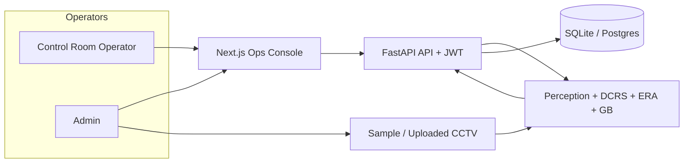
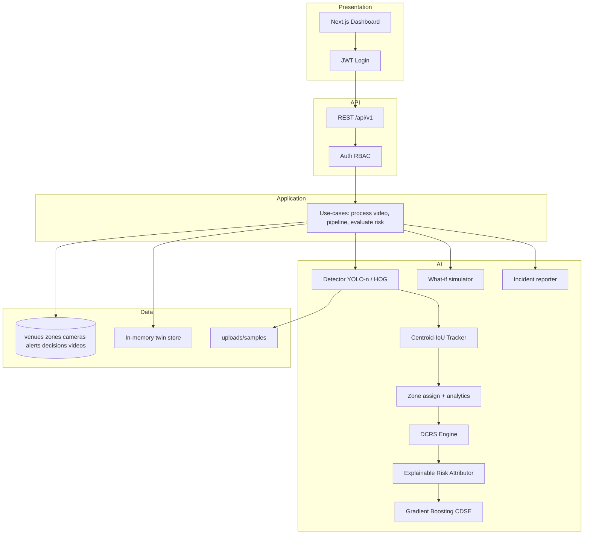
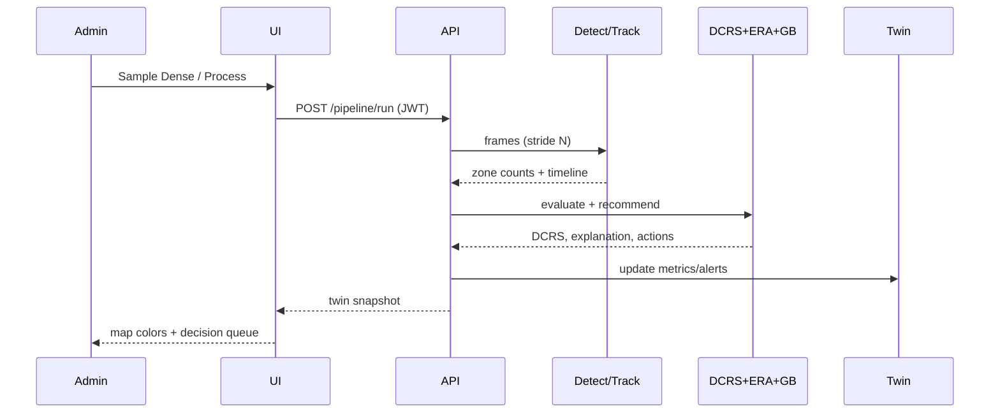

# CrowdPulse Architecture (Level A — Panel)

Honest Level A view of what runs today (not future-only modules).

## System context

## Logical layers

## Pipeline sequence

## Module map (repo)

| Path | Responsibility |
|------|----------------|
| `frontend/` | Ops UI: twin, risk, decisions, CCTV, what-if, analytics, report |
| `backend/app/api/` | REST routes + JWT deps |
| `backend/app/application/` | Use-cases (pipeline, process video, evaluate risk) |
| `backend/app/ai/perception/` | Detect, track, zones, analytics |
| `backend/app/ai/risk/` | DCRS |
| `backend/app/ai/xai/` | ERA |
| `backend/app/ai/decision/` | GB recommender + safety filter |
| `backend/app/ai/simulation/` | What-if |
| `backend/app/ai/reporting/` | Incident markdown (Ollama optional) |
| `backend/app/infrastructure/` | DB, seed, twin store, video storage |
| `edge/` | Future / optional edge publisher (Level B) |

## Security
- JWT login (`tsp.operator` / `tsp.admin`)  
- Operator cannot run ingest/pipeline; Admin can  
- Secrets via env (`SECRET_KEY`, `AUTH_REQUIRED`)

## Scale path (Level B — not claimed as done)
Multi-camera fusion, Timescale metrics, Redis streams, ONNX edge nodes — see `FUTURE_SCOPE.md` / design doc.
