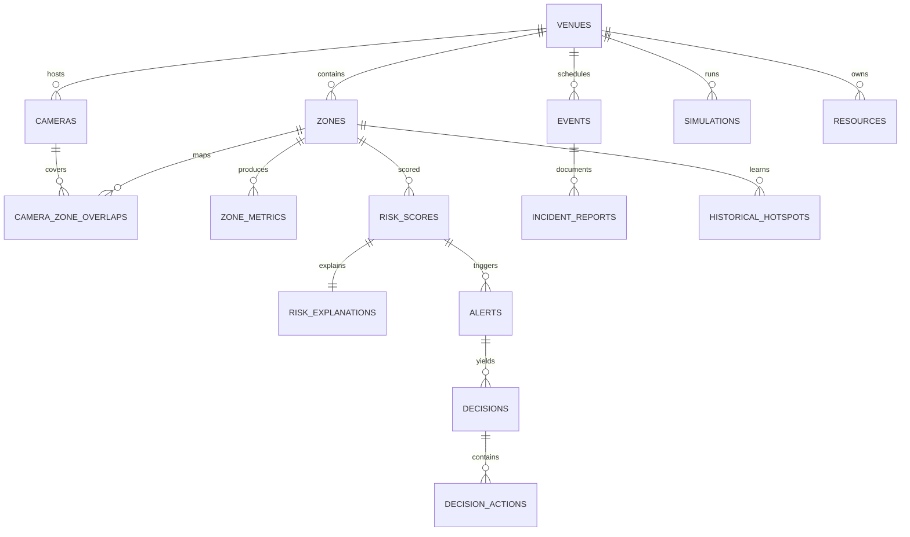

# Database Schema

## ER Overview (Mermaid)

## Tables

### venues
- id UUID PK
- name, timezone, geojson boundary, created_at

### zones
- id UUID PK, venue_id FK
- code, name, polygon GeoJSON, area_m2, capacity, exits JSONB

### cameras
- id UUID PK, venue_id FK
- code, stream_url, homography JSONB, fps, edge_node_id, is_active

### camera_zone_overlaps
- camera_id, zone_id, overlap_ratio, calib_meta JSONB

### detections (Timescale hypertable)
- time TIMESTAMPTZ, camera_id, track_local_id, bbox, conf, embedding VECTOR nullable

### fused_counts (hypertable)
- time, zone_id, count, density, mean_speed, flow_vector JSONB

### zone_metrics (hypertable)
- time, zone_id, metrics JSONB

### risk_scores (hypertable)
- time, zone_id, dcrs, band, horizon_minutes, forecast_json

### risk_explanations
- id, risk_score_id, contributions JSONB, narrative TEXT

### alerts
- id, zone_id, severity, status, dcrs, created_at, ack_by, ack_at

### decisions
- id, alert_id, engine_version, rationale JSONB, created_at

### decision_actions
- id, decision_id, action_type, payload JSONB, status, executed_at

### simulations
- id, venue_id, scenario JSONB, status, created_by

### simulation_results
- id, simulation_id, result JSONB, predicted_peak_dcrs

### resources
- id, venue_id, type (guard|medical|vehicle|gate), location, capacity

### resource_assignments
- id, resource_id, zone_id, decision_id, start_at, end_at

### events
- id, venue_id, name, starts_at, ends_at, expected_attendance

### historical_hotspots
- id, zone_id, event_phase, score, sample_count, updated_at

### incident_reports
- id, event_id, summary, timeline JSONB, pdf_uri, created_at

### users / audit_logs
- RBAC users and immutable audit trail
